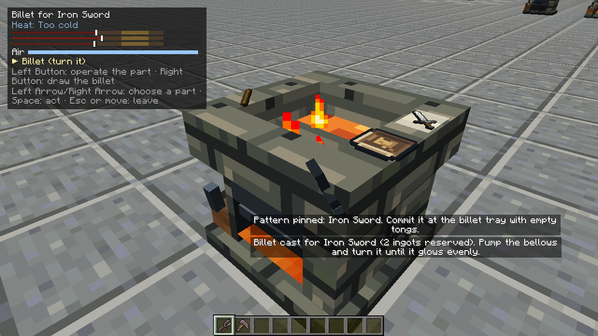
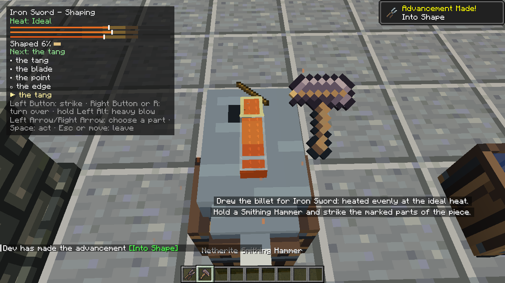

# Immersive Smithing

**Make metal equipment with your hands.** Immersive Smithing turns the familiar sword, tool and armor crafting routine into a small workshop project. Melt metal in a Smith's Forge, heat a billet with the bellows, hammer it into shape on a Smith's Anvil, then quench it in a water-filled Smith's Trough. The work happens right at the stations, in the world: how evenly you heat, how well your blows land and how you quench decide how durable and effective the finished piece will be. A basic item takes about a minute to make, but a piece you are proud of can stay with you for a long time.

## Set up your workshop

You can start with **stone Smithing Tongs**, a **stone Smithing Hammer** and three stations:

- **Smith's Forge:** Melts your metal. Craft it with five brick blocks, a furnace and three pieces of stone crafting material.
- **Smith's Anvil:** Holds the hot workpiece while you shape it. Craft it with three iron ingots and four stone bricks. Your ordinary Minecraft anvil is still used for repairs and renaming.
- **Smith's Trough:** Holds the water used to finish your work. Craft it with seven wooden slabs and an iron ingot.

The optional **Smith's Grindstone** refines finished gear using experience levels. Its recipe uses a regular grindstone, two iron ingots and a diamond. Tongs and hammers come in stone, iron, diamond and netherite versions. Stone tools are enough to begin; better hammers recover faster between blows and better tools last longer, but they never grant a free quality bonus.

You'll receive the **Smithing Guide** when you first obtain smithing tools. It explains the stations, metals, the work at each station and common problems in game, and it reads like a written book. Every Immersive Smithing screen uses Minecraft's own look. You can also craft another guide with a book and coal or charcoal.

## From ingot to equipment

1. **Heat the metal.** Right-click the *upper half* of the Smith's Forge with ingots, nuggets, raw metal, metal blocks or old metal equipment. One click adds one item; sneak and right-click to add a stack. Each forge holds one kind of metal at a time. Put fuel such as wood, coal or charcoal in the *lower half*, then light the forge with Flint and Steel or a Fire Charge. A bucket of lava heats it without ignition. Wait until the metal is molten and the forge is ready.
2. **Choose what to make.** Use the ready forge to open its *pattern book*. It shows the items you can make with the metal in the forge and the components in your inventory; an iron sword, for example, needs two iron ingots' worth of metal and a stick. Choosing one pins its plan beside the billet tray. Use the tray with *empty Smithing Tongs* to commit it: the metal is reserved, the components are set aside and a billet is cast.
3. **Heat the billet.** Pump the bellows and turn the billet along the tray so its cooler end sits over the hottest coals. When all of it glows evenly in the ideal band, draw it out with your tongs. The more evenly and well it was heated, the better the Forge score.
4. **Shape it.** Set the billet on the Smith's Anvil and strike the marked parts with a Smithing Hammer. The metal deforms where your blows land; some work needs the piece turned over, and blows on cooling metal do less. When it cools, rest it in the mouth of the forge to reheat it. Nothing is lost, and there is no timer. Good blows at the right heat make a good Anvil score.
5. **Quench and finish.** Lower the shaped piece into a Smith's Trough filled with water (one bucket gives four quenches by default), hold it under until the hiss fades, and lift it out. Fit its handle or other components at the anvil and collect your finished item.

Using a station brings up a framed **cinematic** close-up of the work, with the station's status (heat in words and bands, the work left and the next part) beside it. Prefer to stay in your own eyes? Switch to the **shoulder** view or to **world** view in the options. You can leave at any moment with Escape or a movement key, and every action works with the mouse or from the keyboard.

**A few useful workshop tips:** Netherite melts only with lava. Hot metal cools in your tongs and on the anvil, never while you are away from the world. If a workpiece drops as an item, hold empty tongs and right-click in the air to pick it up. Between heats the fire banks for a minute, so a cooling piece can go straight back on the rest. Walking away never loses work: the billet stays on the tray and the piece on the anvil. Cancelling a committed billet (use it twice) gives your components back.

## Your skill shows in the finished piece

Every forged item has two scores, each from 0 to 100. **Forge quality** controls durability, while **Anvil quality** affects the item's performance, such as weapon damage, tool mining speed or armor protection. A score of 50 gives ordinary performance. By default, Forge quality ranges from 75% to 125% of normal durability, and Anvil quality ranges from 85% to 115% of normal performance. The overall label combines both scores:

- **Crude:** Below 35.
- **Standard:** 35 to 69.
- **Fine:** 70 to 89.
- **Masterwork:** 90 and above.

There are no timers. Servers can turn on destructive overheating: metal left far too hot for three seconds burns, and the piece comes out **Faulty**. Faulty gear still works, but by default it has half the normal durability and 70% of normal performance. Hover over finished equipment, or hold Shift for more quality detail.

Want to improve a good piece? Rest it at the **Smith's Grindstone**, pick durability or performance (the exact step and experience-level cost are shown), and hold its edge to the turning wheel for one pass. Levels are taken only when a pass completes. Each refinement adds five points up to 100, and enchantments stay on the item. Gear that was never graded starts from Standard, and nothing changes until you pay. Faulty equipment cannot be refined, but it can be melted down and forged again.

## Reforge, recycle and leave your mark

Recognized metal equipment can be put back into a forge, including enchanted or Faulty pieces. By default, you recover all of its metal. Melting removes the old item's enchantments, quality, name and other personal touches, so check the piece before recycling it.

Every completed piece records its maker in the tooltip. You can give your work a title and up to three lines of inscription by sneak-using the Smith's Anvil while holding it. The smith who made it can sign it; Faulty work cannot be signed. The maker's mark survives normal repairs, enchanting, dyeing and supported upgrades. Melting the item removes it.

## Metals and other mods

Iron, gold, copper and netherite are built in. The forge also recognizes many metals added by other mods. A nugget counts as one metal unit, an ingot or raw metal as nine, and a storage block as 81. Metals melt at different speeds, and each forge handles one metal family at a time.

Immersive Smithing looks for eligible weapons, tools, armor and metal shields made mostly of one metal (the one they are repaired with), plus ordinary components such as sticks, leather or small fittings of another metal. It gives those items forging recipes and, by default, replaces the recipes it can reproduce. Recipes that only reshape a finished piece, such as a sword made into a spear, keep working at the crafting table, and the piece keeps its quality. Recipes that mix metals or cannot be identified reliably are left alone. **JEI**, if installed, shows available smithing recipes in a dedicated category, including recipes detected from other mods.

Some notable integrations include:

- **Spartan Weaponry:** Smith its metal weapons across all 24 weapon types, including throwing weapons, longbows and heavy crossbows. Thrown weapons retain their quality, and arrows or bolts inherit quality from the bow or crossbow that fires them.
- **Epic Fight:** Built-in forge recipes for every metal weapon, with no setup: longswords, greatswords, tachis, daggers, spears and gloves, and the uchigatana from iron and a diamond. The wooden bokken gets a crafting recipe. Quality counts once, in either hand and in Epic Fight's battle mode.
- **Epic Knights and its add-ons:** Built-in forge recipes for the metal weapons, armor and shields of Epic Knights, Addon, Slavic Armory, Antique Legacy, Ice and Fire, Ores and Alloys, Dark Ages, Open Helms, Seven Kingdoms, Artilleries and Firearms, Medieval Boomsticks release/alpha, Japanese Armory, Ingots Addition, Thirty Years War and Epic Fletchery. Costs follow active recipes; structural upgrades consume the exact base and added metal. A knight chestplate needs a halfarmor chestplate and five steel plates’ worth of steel. Gilding, darkening, visor swaps, native assembly, ammo, alloys and rare loot retain their own requirements. Cosmetic transformations preserve quality and the original maker. Supported ranged shots use the actual firing weapon’s quality once. Overgeared, TerraFirma and TerraFirmaGreg bridges retain native progression and equipment effects.
- **Simply Swords:** Smith its metal weapons on anvil patterns shaped like them, from twinblades to chakrams. Its abilities and thrown weapons use quality too. Runic weapons, rerolls and unique weapons keep their usual way of being obtained, and unique weapons can't be melted down.
- **Modded metals and upgrades:** Built-in material definitions cover metals from Cataclysm, Ice and Fire, Iron's Spells 'n Spellbooks, Botania and MCA, among others, when those mods are present. Some upgrades are forged directly from the new metal, while others consume an existing piece and add metal to it. Netherite gear is forged directly from netherite ingots without a smithing template or a diamond base. Armor trims remain at the smithing table.
- **Jade:** Shows useful station information in its block overlay when installed.
- **Modpacks and datapacks:** Pack makers can add metals (with their own heat bands), recipes, recycling rules and process profiles describing how each kind of piece is worked. Existing progression mods can respond when a player finishes smithing an item.

Toolsmiths and Weaponsmiths can sell smithing tools, and they and Armorers can sell forged equipment. Eligible gear found in loot also receives a quality grade, usually Standard under the default settings. That includes loot-only pieces such as Simply Swords' runic and unique weapons and Epic Knights' relics.

## Multiplayer, automation and options

The server checks every action and calculates the results; players only send what they do. One player works a station at a time, and a committed billet stays its smith's for a few minutes after they last touch it. Hoppers and pipes can feed metal and fuel into a forge and water into a trough, and comparators can read the forge and trough. Choosing a recipe, shaping the item and quenching it are jobs for a player.

Server settings cover recipe replacement, which items are detected, melting, fuel, station capacity, heating and cooling, blow recovery, quality, recycling, trades and more. Client settings offer the camera mode (cinematic, shoulder or world), reduced motion, hold or toggle for held actions, expanded numeric status, reduced screen shake and flashes, fewer particles, higher contrast, larger or colorblind-friendly guides, cue sounds and numeric quality scores. Visual options never change the scoring. Server operators can use `/immersivesmithing report` and `/immersivesmithing recipe <item>` to investigate a missing modded recipe.

## Requirements and upgrading

- **Minecraft 1.20.1**, **Forge 47 or later** and **Java 17**.
- Install Immersive Smithing on **both the client and server** for multiplayer.
- **JEI** and **Jade** are optional. Compatibility features for other mods apply when those mods are installed.

**Coming from Ote's Smithing?** Immersive Smithing uses a new mod ID and is not compatible with Ote's Smithing world data or datapacks. Old stations, tools, workpieces and quality data do not carry over. Back up your world before switching, and remove the old Ote's Smithing jar so the two mods do not load together.

## Links

- [Source code](https://github.com/otectus/ImmersiveSmithing)
- [Report an issue](https://github.com/otectus/ImmersiveSmithing/issues)
- [Changelog](https://github.com/otectus/ImmersiveSmithing/blob/main/CHANGELOG.md)
- [Datapack and developer documentation](https://github.com/otectus/ImmersiveSmithing/blob/main/docs/API.md)

Licensed under GPL-3.0.
