# Hands-on, cinematic smithing: report (1.3.0)

The forge and anvil minigames were replaced with work done at the stations, in the world: a pattern book and a
committed billet at the forge, bellows and turning to heat it evenly, aimed blows that deform the piece on the anvil,
reheating on the forge's rest, a physical quench, fitting components at the anvil and an optional grindstone pass. The
server stays authoritative and every piece in progress from 1.2 migrates. What changed for players, operators and
developers: [CHANGELOG](../../CHANGELOG.md) and [MIGRATION.md](MIGRATION.md); the formats: [docs/API.md](../API.md); the
plan and its decisions: [the plan](../plans/2026-11-13-cinematic-overhaul-plan.md).

**Short version.** All 145 GameTests pass, alone and with Spartan Weaponry, Spartan Shields and Immersive Armors. Every
active recipe resolves to a process profile through its anvil pattern (33 of 33 in the vanilla test profile, 147 of 147
with the compatibility mods). In a real client, the pack-test agent forged an iron sword from the pattern book to the
finished piece through the same keys and clicks a player uses (100/100, two reheats), refined a second sword at the
grindstone, struck a blow in World view, opened every station's focused view at GUI scale 3, the anvil's at 320 x 240
and at scale 4, and the forge's and anvil's with every accessibility option on, and measured frame times with 32 active
forges. The same run passed in the Ultima modpack on the production jar, and two real clients on a dedicated server
saw each other's work.

## Checks

| Check | Command | Result |
| --- | --- | --- |
| Compile | `gradlew-quiet.sh . compileJava`, `compileGameTestJava`, `compilePackTestJava` | Pass |
| GameTests | `gradlew-quiet.sh . runGameTestServer` | 145 of 145 required tests passed |
| GameTests with compatibility mods | `gradlew-quiet.sh . runGameTestServer -PcompatMods` | 145 of 145 |
| Process coverage | written by `WorkMigrationGameTests.everyPatternAndRecipeHasAProcess` (same as `/immersivesmithing process`) | [vanilla](validation/process-coverage-vanilla.txt): 33 recipes, all by pattern, no rejected profiles; [compatibility mods](validation/process-coverage-compat-mods.txt): 147, all by pattern |
| Client smoke test | `gradlew-quiet.sh . runClient -PsmokeTest` | Pass, every check true ([result](validation/packtest-result.json)) |
| Two clients on a dedicated server | `python3 tools/visual-test/multiplayer_visual_test.py --server-libraries build/prodserver/base/libraries` | Pass on the production jar: both clients joined on protocol 6, recipes matched the server's (1187), each saw the other's tongs and hammer swings, an anvil pickup with tongs cleared the piece on the server and both clients ([summary](validation/multiplayer/summary.json)) |
| Showcase recording | `gamescope -W 1280 -H 720 -w 1280 -h 720 -- python3 tools/showcase/record.py --take hands-on-03`, then `python3 tools/showcase/edit.py --take hands-on-03` | Pass in survival with a coal fire (100/100, two reheats): 92 s of footage from the game's framebuffer, edited to a 43.8 s captioned sneak peek in `output/sneak-peek/` (not committed). Silent: see below |
| Artwork | `python3 tools/generate_textures.py --check` | 31 textures match the source; 208 model faces at 1:1 UVs |
| Station models | `python3 tools/model_preview.py --check` | Pass: four stations 33/38 cuboids, 152/228 faces |
| Assets | `check_mod.py` | 0 errors, 0 warnings (13 notes about tier item models, unchanged) |

The GameTests cover the job reservation and refund, the heat rules (bellows, tray positions, reheat, a banked fire), blows (faces,
prerequisites, too cold, overwork and correction, recovery), quench boundaries and early lifts, a full iron sword from
billet to collection with one `ItemSmithedEvent`, the grindstone charging only on a completed pass, migration of
version 1 and 2 pieces in every holder, unreadable records kept raw, packet validation (instance, reach, sequence,
budget, lease) and the existing recipe, casting, netherite and Epic lifecycle suites on the new flow.

## Found and fixed while verifying

Running the real client, the pack and the recording turned up problems the GameTests could not see. All are fixed and
covered by the runs above:

- **Space left the work view.** The default action key is also the jump key, and the work view checked movement keys
  first. Work keys now come first; a key repeat is not another press; in toggle mode a second press ends a hold.
- **Keyboard-only reheat.** The anvil's work view had no way to lift the piece off or set a carried one down; it now has
  both targets when the smith holds tongs.
- **Status panel.** Wrapped lines overflowed the panel; the World-view panel and, with a pack's larger font, the
  focused panel covered station messages. The panel lays out correctly, the World-view panel sits above the crosshair, and
  in a work view messages are centred beside the panel.
- **Hot metal looked brown.** The billet texture was dark grey under the heat tint and the palette put the ideal band at
  dull red; the texture is now a pale base and the ideal band reads orange to yellow-orange. The hammer was too large
  and hid the piece between blows; it is smaller and waits beside the work.
- **"The fire is out" on a lit forge.** Putting a piece on the rest right after drawing the billet reported the fire as
  out, because nothing had been heating that tick; the message now asks whether the forge can heat the piece.
- **Solid fuel went out between heats.** With coal, the fire died while the smith was at the anvil, so every reheat
  needed a new spark. The fire now banks for a minute between heats without burning fuel (GameTest
  `bankedFireReheatsWithoutANewSpark`).
- **The quench's end cue** had no visual; the steam now thins and the surface settles.

## Ultima release gate

The release jar and the pack-test agent (`build` and `packTestJar`), then `python3 tools/packtest/ultima_pack_test.py
--expect spartan,shields,upgrades --label <label>`: the production (reobfuscated) jar in an isolated copy of the Ultima
CurseForge instance (354 other mods; the real instance is never modified), with a game window on the desktop.

The gate ran three times. The first two runs found the issues listed above; the last ran on the final jar.

| Gate, final jar | Result |
| --- | --- |
| Verdict | pass: no freeze, title screen after 60 s, agent pass with every check true, 0 stack traces, 0 error lines and 0 crash reports from this mod ([summary](validation/ultima-final-gate/summary.json); first run: [summary](validation/ultima-first-gate/summary.json)) |
| Smithing data in the pack | 20 material families, 327 explicit and 195 automatic recipes, 441 crafting recipes replaced; the Spartan Weaponry and Spartan Shields checks true |
| Hands-on run in the pack | iron sword 100/100 (heat preparation 1000, 206 heating ticks, 19 blows, 2 reheats, quench control 1000); grindstone pass 94 to 99; World-view blow accepted; Shoulder view and every focused view opened |
| Frame times, 32 forges empty / active | 266 / 259 fps; 95th percentile frame interval 8.7 / 9.1 ms (the first run measured 165 / 156: the same spread as in the development client) |

The camera hook, the work views and the pack's own HUD, fonts and first-join screens (Origins, Townstead) coexisted.
In the pack, as in the development client:

| | | |
| --- | --- | --- |
| 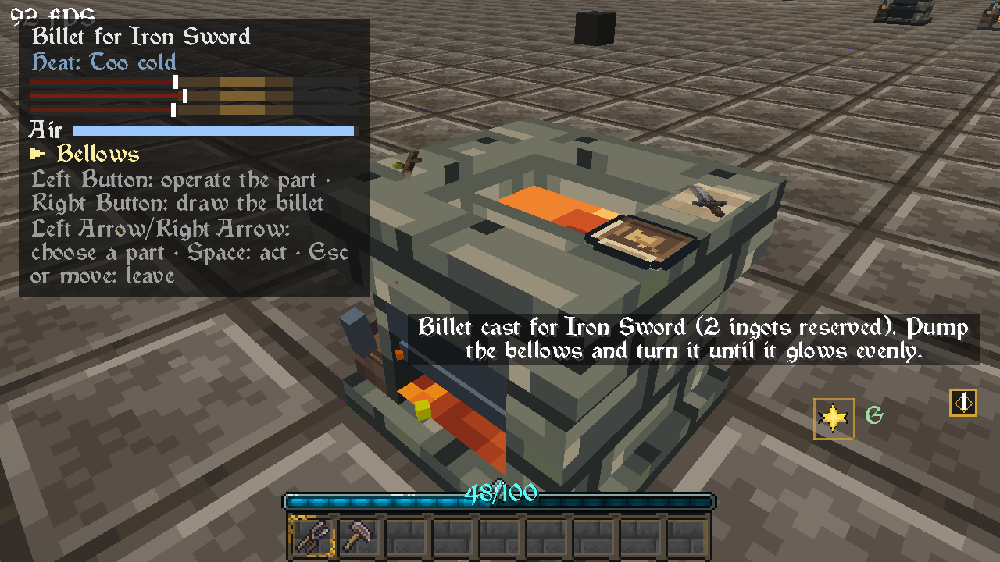 | 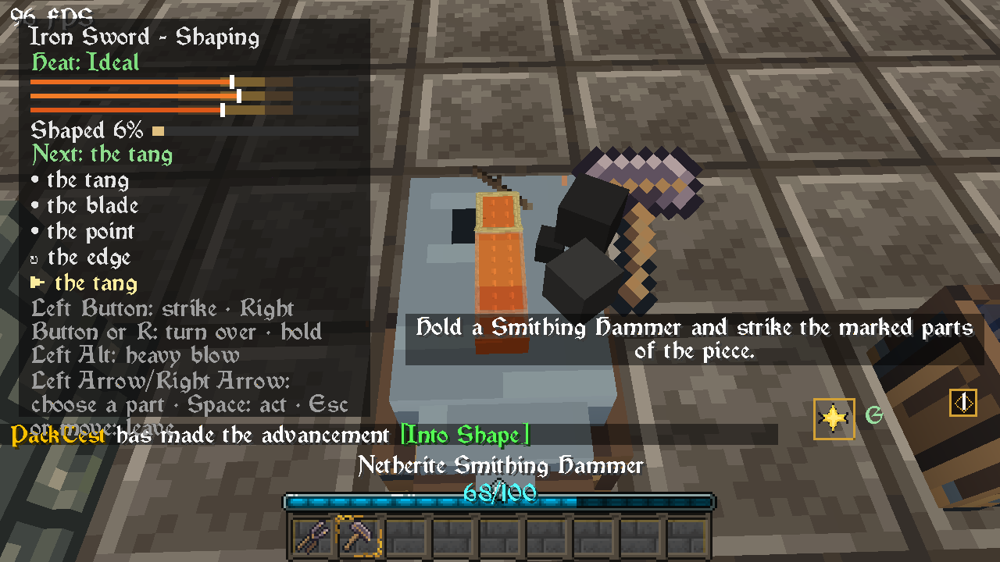 | 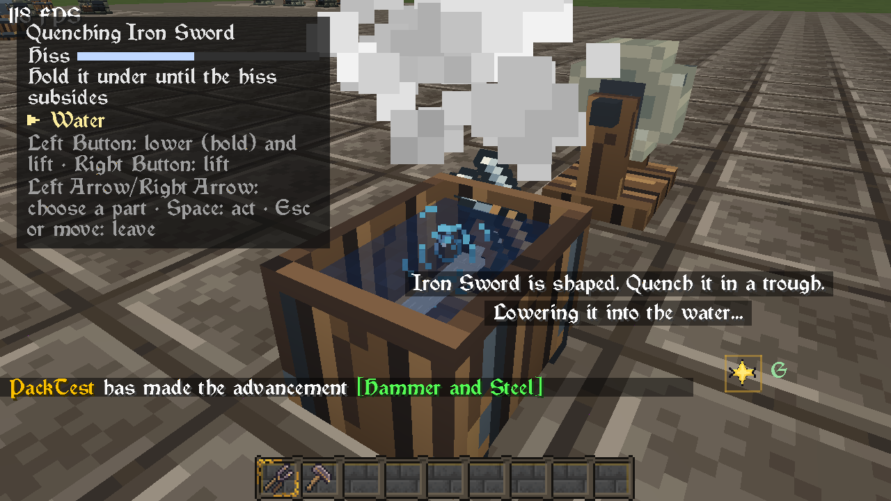 |

## The hands-on run in the client

`SmithDriver` (pack-test agent) plays like a careful smith using only the focused views' own input: it presses the
configured action key on the selected part, the turn-over key, types into the pattern book's search and presses Enter,
selects hotbar slots and uses blocks. Everything it does reaches the integrated server as a player's packet.

| Step | Recorded |
| --- | --- |
| Pattern book | opened from the forge view, "iron sword" searched, chosen; plan pinned |
| Commit | billet cast, 18 units reserved, the stick escrowed |
| Heating | 205 ticks (10.3 s), 16 bellows strokes, 14 turns; zones at 5961 / 6372 / 5974 when drawn (ideal band 5800 to 7200) |
| Heat preparation | 1000 of 1000 |
| Shaping | 19 blows, turned over once, 2 reheats on the forge's rest |
| Quench | control 1000 of 1000 |
| Result | iron sword, forge score 100, anvil score 100, not Faulty; 9 focused views opened over 1330 to 1370 client ticks (about 67 s) |
| Grindstone | second sword (94/82): one pass on durability, 94 to 99 |
| World view | a left click on the anvil was accepted as a blow: progress 0 to 61 per mille |
| Shoulder view, all stations' views at scale 3, 320 x 240, scale 4, accessibility | all opened |

The table is the development client's final run. Over eight runs (five smoke tests in the development client, three
Ultima gates) and the survival showcase take with a coal fire, the result was the same every time: 100/100, two reheats,
heat preparation and quench control 1000. The driver acts on the client's view of the heat, so the path there varied a
little with client timing: one Ultima run heated for 211 ticks with 17 strokes and 7 turns and needed 20 blows.

## Performance

Frame times from the smoke test, measured over at least 180 frames and 3 seconds after 60 warm-up frames, with vsync off,
the frame limit at 260, render distance 6 and a fixed spectator camera over 32 forges.

| Scene | Average fps | Median frame interval | 95th percentile interval | Median render tick |
| --- | --- | --- | --- | --- |
| 32 empty forges | 237.6 | 4.09 ms | 10.02 ms | 1.08 ms |
| 32 forges melting and burning | 226.6 | 3.21 ms | 10.10 ms | 1.36 ms |

Intel UHD Graphics (ADL-S GT1), Mesa 26.2.6, OpenGL 4.6; about 700 sampled frames each, final run. Earlier runs during this
work measured 207 to 280 fps for the active scene, so differences of this size are run-to-run noise. These are single runs on the
development machine, not a before/after comparison: the 1.2 measurements in
[docs/station-optimization](../station-optimization/REPORT.md) used other scenes. Each work view draws one procedural
piece (at most a few hundred quads, no per-frame mesh allocation) and the camera override is a single pose per frame.

## Screenshots

From the final smoke-test run, in the client's default look (no shader pack, the developer environment's textures).

| | |
| --- | --- |
| 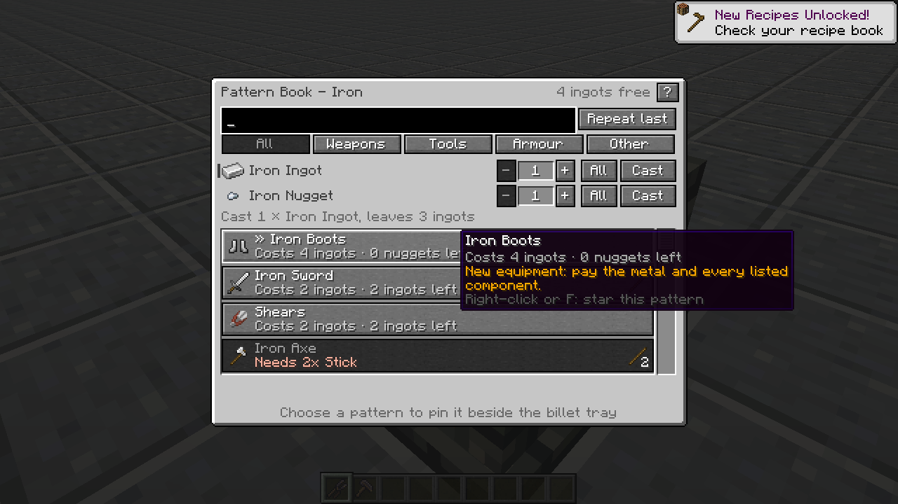 | 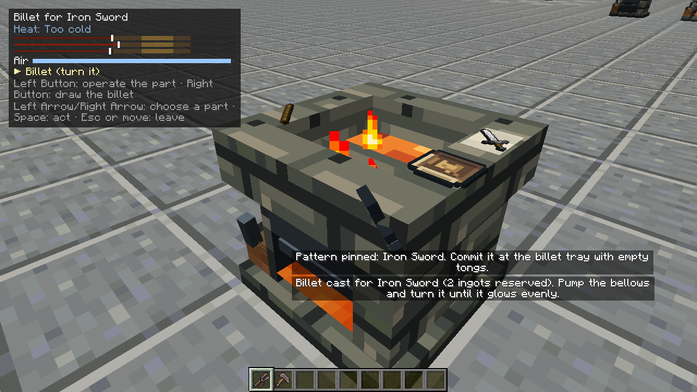 |
| Pattern book, opened from the forge's work view | Heating: bellows, turning, three heat zones |
| 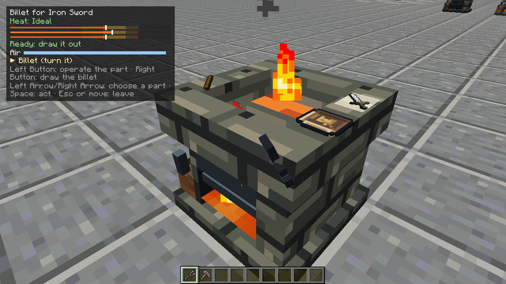 | 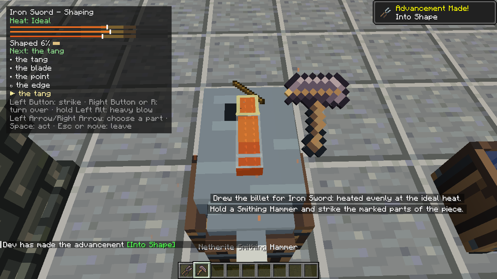 |
| Billet evenly in the ideal band | First blows: the hot piece, its next part outlined, the hammer beside it |
| 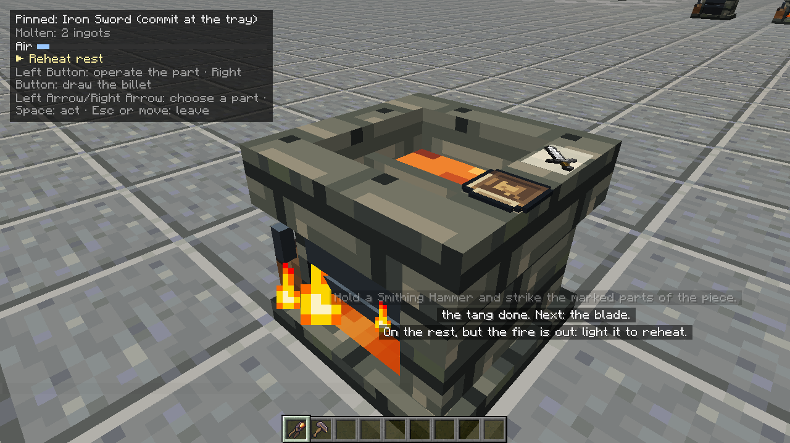 | 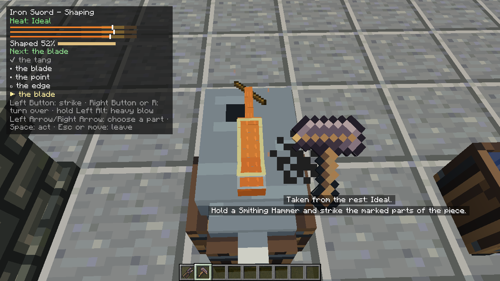 |
| Reheat on the forge's rest; progress kept | Half shaped |
| 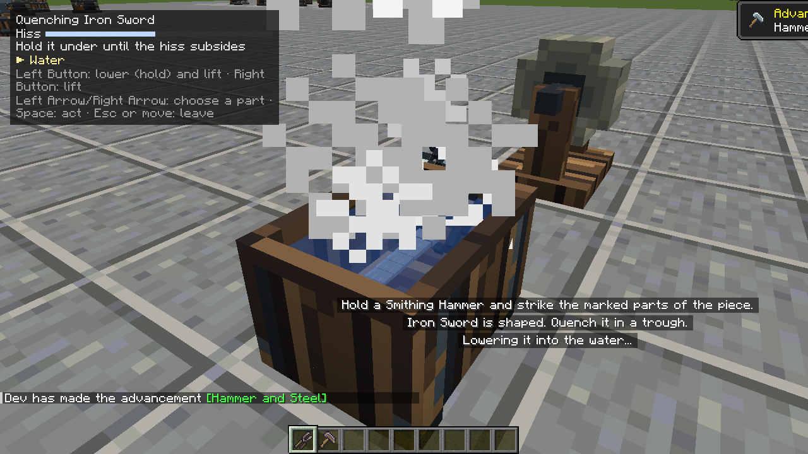 | 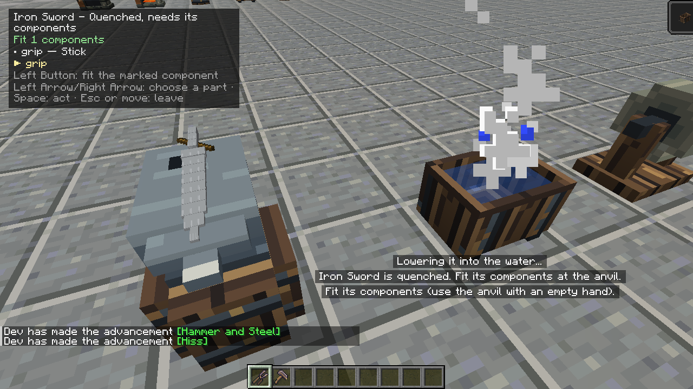 |
| Quench: held under until the hiss fades | Fitting the grip at the anvil |
| 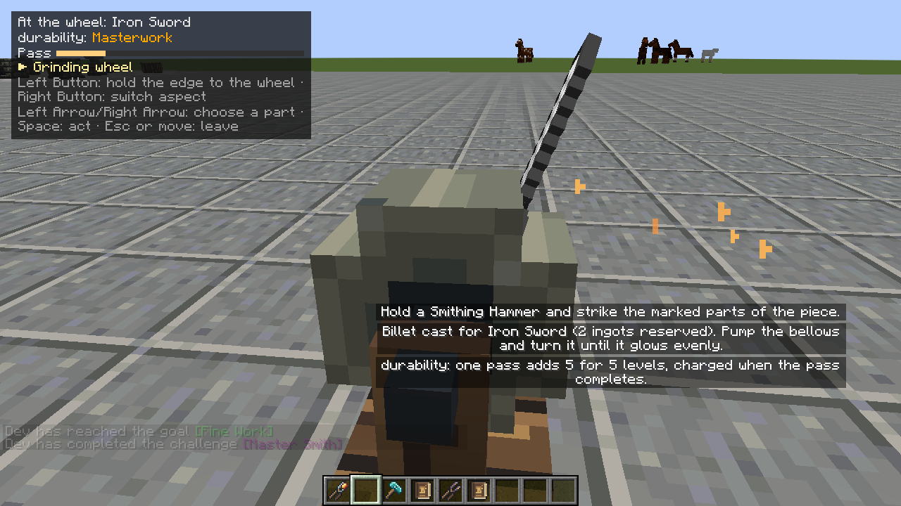 | 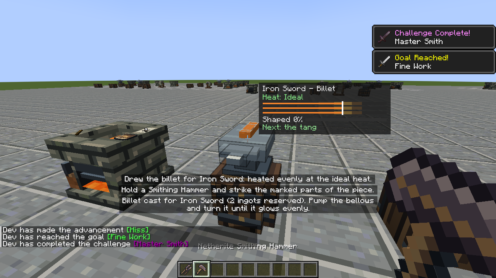 |
| Grindstone pass: the edge held to the wheel | World view: the same status beside the crosshair |
| 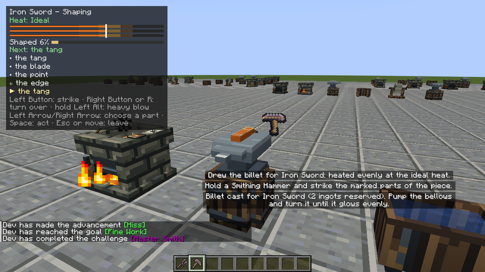 | 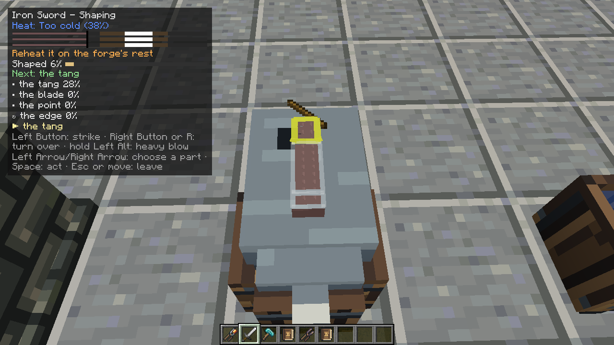 |
| Shoulder view | Accessibility: numbers, high-contrast guides, reheat hint |

Before (1.2 minigames): [forge](../vanilla-gui/after/packtest_forge_play.png), [anvil](../vanilla-gui/after/packtest_anvil.png).
Every other capture of the run (GUI scales 1 to 4, 320 x 240, the guide, JEI, station galleries by day and night,
effects) is in the client's `run/screenshots/packtest_*.png` after `runClient -PsmokeTest`.

## Not verified here

- **Translations.** New and changed text is in English; German, French, Spanish and Chinese fall back to English for
  those lines.
- **Sounds.** The twelve new sound events point at vanilla sounds; there is no new audio.
- **The two-client Epic Knights upgrade phase.** Ported to the job model (pin, commit; another smith's use, book, draw
  and cancel requests refused; a reload keeps the job; the owner's confirmed cancel refunds the decorated base once), it
  runs only with the Epic Knights jars (`--extra-mods ... --expect epicknights`) and was not run. The base two-client
  run passed (see Checks).
- **Store screenshots.** `StoreScreenshots` was ported and compiles; it was not run because it switches the game to
  1920 x 1080 fullscreen on the desktop.
- **Sound in the recording.** The game's bundled OpenAL could not open its PulseAudio backend on this PipeWire 1.6
  desktop (`Failed to open OpenAL device`), so the showcase's private audio sink was unreachable; the take was filmed
  muted rather than played into the desktop. Earlier takes on this machine had sound.
- **Station benchmark.** The 1.2 station benchmark (`runClient -PstationBenchmark=<label>`) was not re-run, so there is no
  like-for-like comparison with [the 1.2 measurements](../station-optimization/REPORT.md); the frame times above come from
  the smoke test and the Ultima gate.
- **Other camera mods.** The camera hook is `require = 0` with a World-view fallback. It ran in the development client and
  in Ultima; camera mods outside Ultima (Shoulder Surfing, Camera Overhaul and the like) were not tested.
