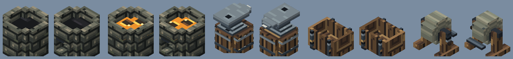
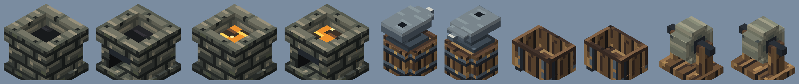
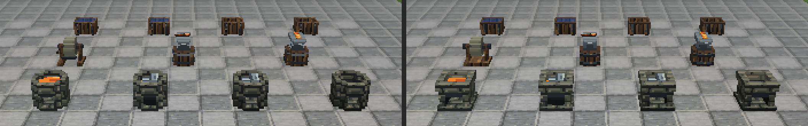
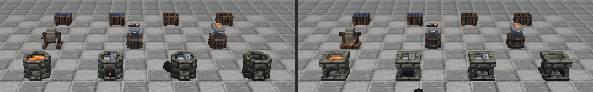
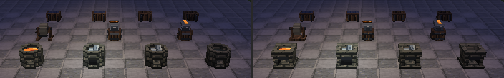

# Station models: optimization report (1.2.0)

The forge, anvil, trough and grindstone were rebuilt from fewer, larger boxes, within a budget of cuboids and faces,
with their outlines and collision rebuilt to match. This report gives the counts before and after, what was measured
in game, and what was not.

**Short version.** The stations' geometry fell by 70 % (516 to 155 model faces for the four stations), their
outlines decompose into 5 to 10 boxes instead of 11 to 36, and the CPU time to mesh a station into a chunk fell by
40 % to 78 %. Those are measured directly. Frame rates are another matter. With a selection outline on the forge or
the anvil, median frames were consistently shorter (by 0.17 to 0.28 ms). In the other scenes, from one station to
128 in use, the differences are smaller than the spread between runs of the same tree, so this report does not claim
a frame-rate gain for them. Fewer faces are not, by themselves, a measured FPS gain.

## What changed

| Station | Model cuboids / faces before | after | Budget | Outline boxes per facing before | after | Outline edges before | after |
| --- | --- | --- | --- | --- | --- | --- | --- |
| Forge | 37 / 222 | 10 / 44 | 14 / 84 | 22 to 25 | 10 | 108 | 66 |
| Anvil | 27 / 162 | 8 / 41 | 10 / 60 | 32 to 36 | 10 | 270 | 84 |
| Trough | 11 / 66 | 7 / 32 | 7 / 42 | 11 | 5 | 96 | 24 |
| Grindstone | 11 / 66 | 7 / 38 | 7 / 42 | 13 | 10 | 150 | 120 |
| Four stations | 86 / 516 | 32 / 155 | 38 / 228 |  |  |  |  |

The lit forge (`smiths_forge_lit`) only swaps the coal texture, so it has the forge's geometry. Bands, straps and
rivets that were separate boxes are now painted on two new textures (`block/anvil_stump`, `block/trough_staves`); the
`block/iron_strap` texture is gone. Every face keeps a 1:1 texel density (`tools/generate_textures.py --check`).

Model previews, before (top) and after (bottom), each station from the north-east and the south-west; generated by
`tools/model_preview.py` from the model files:




In game, before (left) and after (right), with fuel, molten metal, a hot workpiece and water:





Crops of the client smoke test's station gallery (`packtest_stations_*`), the same staging and camera in both trees,
enlarged three times. The four forges are empty, loaded with iron, lit and melting, and holding a hot workpiece; the
anvils hold a forged and a shaped workpiece; the troughs hold from no water to full.

## Renderer anchors

The block entity renderers draw into the new geometry:

- the forge's fuel and lava lie on the firebox floor between its walls (x 4 to 12, z 1 to 12, y 3/16);
- the molten pool fills the basin inside the rim stones (x and z 3 to 13), rising from the hearth (y 10.25/16) to
  below the rim top (13.5/16);
- the hot workpiece lies on the anvil's striking face at the top of the block, and the trough's water stays inside
  its staves;
- the grindstone's sparks leave the wheel.

`StationShapeGameTests.shapesKeepTheWorkingSurfaces` checks the surfaces the renderers and players use: the forge's
open basin and firebox mouth, the anvil's striking face at the block top and its horn, the trough's basin and the
grindstone's wheel and axle. `StationVisualGameTests` checks the forge's back wall and projection. The client smoke test
stages every station, idle and in use, in all four facings by day and at night (`run/screenshots/packtest_stations_*`).

## Benchmarks

The pack-test agent's benchmark mode (`StationBenchmark`, `runClient -PstationBenchmark=<label>`) creates a fresh
flat world and measures real render frames in fixed scenes. Settings: 1280×720 window, VSync off, frame limit 260
(unlimited), render distance 8, creative flight, clear weather, daylight cycle stopped, HUD hidden except in the
outline scenes (the outline is only drawn with the HUD shown). Each scene waits 100 ticks after staging, discards 120
frames, then samples at least 600 frames and 5 seconds. It records the average frame rate and the median, 95th and
99th percentile frame intervals.

Scenes: one forge; four stations idle and in use; the same four with the crosshair on each station; 32 and 128
stations idle and in use; the 128 in use with the camera turning (a 70° sweep either side), at night, and with
particles minimal. Grids are rows of all four stations with facings turning per column. "In use" means a forge with 16
iron ingots and 16 coal, lit; an anvil holding a hot iron-sword workpiece; and a trough holding water. A grindstone has
no in-use state. Each outline scene records the block under the crosshair; in all six runs each named its station.

Machine: Intel i7-13700HX, NVIDIA RTX 4050 Laptop GPU (driver 615.78.08, OpenGL 4.6) under XWayland on Hyprland,
Java 17.0.20.1. The "before" tree (see "Reproducing") and this tree were alternated three times (after 1, before 1,
after 2, before 2, after 3, before 3). Another session was building an unrelated project on the same machine
throughout. The load averages per run are in [validation/runs.txt](validation/runs.txt), and the raw results are
[validation/](validation/) (`station-benchmark-<tree>-<run>.json`, aggregated in `summary.json`).

### Geometry-attributable measurements

Per station, from the running client: baked quads in the block model, boxes and edges of the selection outline
(north facing), and the CPU time to tessellate the station into a chunk buffer, as a chunk rebuild does (smooth
lighting on, no face culling; the median of five batches of 2,000 calls after 2,000 warm-up calls, then the median of
the three runs).

| Station | Baked quads before | after | Outline boxes before | after | Outline edges before | after | Meshing time before | after | Vertices before | after |
| --- | --- | --- | --- | --- | --- | --- | --- | --- | --- | --- |
| Forge | 222 | 44 | 22 | 10 | 108 | 66 | 219 µs | 47 µs (-78 %) | 888 | 176 |
| Anvil | 162 | 41 | 32 | 10 | 270 | 84 | 157 µs | 41 µs (-74 %) | 648 | 164 |
| Trough | 66 | 32 | 11 | 5 | 96 | 24 | 65 µs | 33 µs (-49 %) | 264 | 128 |
| Grindstone | 66 | 38 | 13 | 10 | 150 | 120 | 65 µs | 39 µs (-40 %) | 264 | 152 |

Within a run, the five batches spread by 2 % to 27 % (highest minus lowest, over the median). Runs 1 and 2 of each
tree agree within 8 %; before 3, measured under the heavy load described below, was about 60 % slower, so the medians
are runs 1 and 2's level. The reduction is far larger than either spread. Meshing is the work a chunk rebuild does
when a station is placed, broken or changes state, or when its chunk is loaded. A 128-station workshop (32 of each)
costs about 5 ms of meshing instead of 16 ms, spread over the chunk builder threads. The outline's boxes and edges are
tested and drawn every frame for the targeted block.

### Frame times

Average frames per second (and median frame time) of each run. Runs 1 and 2 of each tree ran at a load average of
3.3 to 5.4; runs 3 ran while another build loaded the machine (load average 12 to 17) and are 2 to 4 times slower
across the board.

| Scene | before 1 | before 2 | after 1 | after 2 | Change, runs 1-2 | before 3 | after 3 |
| --- | --- | --- | --- | --- | --- | --- | --- |
| one forge, idle | 4239 (0.16 ms) | 3282 (0.16 ms) | 3763 (0.16 ms) | 3502 (0.16 ms) | -3 % | 1030 (0.45 ms) | 4181 (0.17 ms) |
| four stations, idle | 4033 (0.16 ms) | 3792 (0.16 ms) | 3594 (0.17 ms) | 3672 (0.17 ms) | -7 % | 976 (0.49 ms) | 2090 (0.21 ms) |
| outline: forge targeted | 1966 (0.44 ms) | 2062 (0.42 ms) | 2807 (0.26 ms) | 2974 (0.25 ms) | +44 % | 863 (0.69 ms) | 1692 (0.33 ms) |
| outline: anvil targeted | 1400 (0.66 ms) | 1418 (0.64 ms) | 2176 (0.38 ms) | 2276 (0.37 ms) | +58 % | 749 (0.97 ms) | 1465 (0.48 ms) |
| outline: trough targeted | 3592 (0.19 ms) | 3004 (0.20 ms) | 3162 (0.20 ms) | 2791 (0.19 ms) | -10 % | 922 (0.55 ms) | 1969 (0.24 ms) |
| outline: grindstone targeted | 2476 (0.32 ms) | 2294 (0.34 ms) | 2779 (0.27 ms) | 2566 (0.30 ms) | +12 % | 930 (0.58 ms) | 1521 (0.34 ms) |
| four stations, in use | 3229 (0.19 ms) | 3010 (0.19 ms) | 3618 (0.19 ms) | 3626 (0.18 ms) | +16 % | 1027 (0.47 ms) | 1402 (0.33 ms) |
| 32 stations, idle | 3011 (0.20 ms) | 2960 (0.20 ms) | 3484 (0.20 ms) | 3129 (0.21 ms) | +11 % | 968 (0.54 ms) | 1267 (0.38 ms) |
| 32 stations, in use | 3140 (0.24 ms) | 2946 (0.22 ms) | 3359 (0.23 ms) | 4226 (0.21 ms) | +25 % | 997 (0.55 ms) | 1292 (0.40 ms) |
| 128 stations, idle | 2875 (0.26 ms) | 2602 (0.23 ms) | 2942 (0.27 ms) | 3878 (0.22 ms) | +25 % | 897 (0.60 ms) | 2212 (0.35 ms) |
| 128 stations, in use | 1842 (0.50 ms) | 1855 (0.49 ms) | 1882 (0.50 ms) | 2253 (0.40 ms) | +12 % | 833 (0.76 ms) | 1216 (0.57 ms) |
| 128 in use, camera turning | 1660 (0.55 ms) | 1759 (0.48 ms) | 1791 (0.48 ms) | 2122 (0.44 ms) | +14 % | 791 (0.86 ms) | 1064 (0.65 ms) |
| 128 in use, night | 1441 (0.65 ms) | 1662 (0.58 ms) | 1544 (0.61 ms) | 1685 (0.60 ms) | +4 % | 714 (0.99 ms) | 934 (0.80 ms) |
| 128 in use, particles minimal | 1503 (0.62 ms) | 1660 (0.57 ms) | 1606 (0.60 ms) | 1751 (0.57 ms) | +6 % | 732 (0.94 ms) | 998 (0.74 ms) |

Reading the table:

- **Outline on the forge or the anvil: a measured gain.** Median frames were 0.17 to 0.28 ms shorter in runs 1 and 2
  (+44 % and +58 % frame rate), and shorter again in runs 3. This is where the cost follows the shape: the targeted
  block's outline is ray-tested and drawn every frame, and these two outlines went from 22 to 10 and 32 to 10 boxes.
  The grindstone's smaller change (13 to 10 boxes, +12 %) and the trough's (11 to 5, −10 %) are within the noise.
- **Everything else: a lean, not a measured gain.** In six of the other ten scenes (four stations in use, 32 stations
  idle and in use, 128 idle and in use, and the turning camera) both "after" runs were faster than both "before"
  runs, by 11 % to 25 % on average. In the other four (one or four idle stations, 128 at night and with particles
  minimal) they were not. Two runs of the same tree differ by up to 32 % (after 1 and after 2 in "128 stations,
  idle"), and the median frame times moved by at most 0.1 ms. At 1,400 to 4,200 frames per second the stations' meshes
  are a small part of a frame, and chunk meshes are built once and reused.
- **Runs 3** show the same direction (after faster in all 14 scenes) but ran under heavy outside load, before 3
  more so than after 3, so they are not evidence either way.

So, on this machine: fewer faces made chunk meshing and the outline cheaper; any change to the steady frame rate was
smaller than the machine's run-to-run variation. Slower GPUs, integrated graphics or larger workshops were not
measured.

## Checks

| Check | Result |
| --- | --- |
| `python3 tools/model_preview.py --check` | Passed: forge 10 / 44, lit forge 10 / 44, anvil 8 / 41, trough 7 / 32, grindstone 7 / 38; the four stations 32 / 155 against 38 / 228; every blockstate, model and texture resolves. A shrunken budget and a missing texture were both reported as failures when tried. |
| `python3 tools/generate_textures.py --check` | Passed: 31 finished textures, 185 model faces with 1:1 UVs, 5 emissive item models. |
| `python3 /home/otectus/Projects/.mcmod-tools/check_mod.py .` | 0 errors, 0 warnings, 13 notes (the dynamically registered tool tiers' item models, as before). |
| `StationShapeGameTests` (in every `runGameTestServer` profile) | Passed in all 18 profiles: at most 12 boxes per facing (10, 10, 5 and 10), the same cached shape on every call, the same volume in every facing, and the working surfaces in place. |
| `runClient -PsmokeTest`, this tree | Passed every visual, data and runtime check; 47 screenshots, among them the station gallery in four facings by day and at night. |
| `runClient -PsmokeTest`, before tree | Passed; its gallery is the left half of the in-game images above. |
| `runClient -PstationBenchmark=<tree>-<run>`, three runs per tree | Completed; results above and in [validation/](validation/). One "before" run failed to hand over the early window under a load average of 17 and was repeated. |

## Reproducing

```
python3 tools/model_preview.py --check
./gradlew runClient -PstationBenchmark=<label>
# writes run/packtest/station-benchmark-<label>.json and one screenshot per scene to run/screenshots/
```

The "before" tree was this working tree with the 1.1.1 station models, shapes, forge renderer and `iron_strap`
texture restored from git (`HEAD`), and nothing else changed. Alternate the two trees several times on an otherwise
idle machine: frame times move with everything else the machine is doing.
